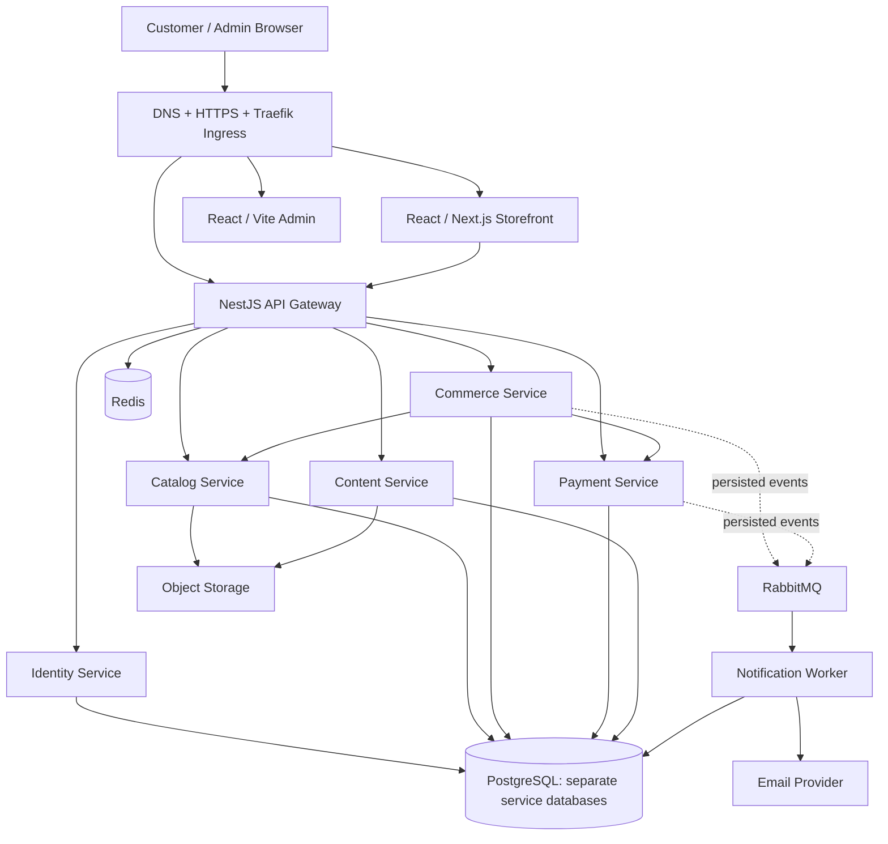

# Random Studio — Implementation & VPS Deployment Guide

NestJS + TypeScript microservices, React storefront/admin, PostgreSQL, Docker aur Kubernetes ke liye implementation blueprint.

**Target VPS:** KVM 8 · 8 vCPU · 32 GB RAM · 400 GB NVMe · 32 TB bandwidth. **Document date:** 10 October 2026.

## Current status

Repository abhi single NestJS starter hai. Neeche listed `apps/`, Dockerfiles, Compose files, Kubernetes manifests aur CI/CD workflows **proposed files** hain; abhi implement/deploy nahi hue. Examples ke prerequisites respective documents mein diye hain.

- New workspace: `C:\xampp\htdocs\random_studio`.
- Existing Laravel reference: `C:\xampp\htdocs\ramdonStudio`.
- Live reference: [randomstudio.in](https://randomstudio.in/).
- Current package declares NestJS `^12.0.1`, TypeScript `^6.0.2`, Vitest aur Oxlint; resolved versions lockfile se confirm karo.
- Pasted note ke 4 vCPU / 8 GB figures ko actual supplied 8 vCPU / 32 GB configuration se replace kiya hai.
- VPS OS, CPU architecture, DNS aur GitHub repo remotely verify nahi hue. Ubuntu 24.04 LTS, Linux amd64, GitHub Actions aur GHCR proposed defaults hain.

## Recommended setup

**Local development: Docker Compose. CI: Docker images. Production VPS: single-node K3s Kubernetes.**

Specified resources initial service set ke liye reasonable starting point hain; real capacity load tests se establish hogi. Single VPS par server failure se complete system unavailable hoga. Kubernetes additional servers ya hardware redundancy create nahi karta.

K3s default **containerd** runtime use karta hai. Docker-built OCI images Kubernetes mein run hongi; Compose production pods manage nahi karega. K3s host par Docker Engine optional hai. [K3s runtime documentation](https://docs.k3s.io/advanced)

| Concern         | Selected approach                                        |
| --------------- | -------------------------------------------------------- |
| Repository      | pnpm workspace monorepo; independent app packages        |
| Storefront      | React + TypeScript through Next.js; SSR catalog pages    |
| Admin           | React + TypeScript + Vite                                |
| Backend         | API Gateway + five domain services + notification worker |
| Communication   | Internal HTTP + RabbitMQ events                          |
| Permanent data  | PostgreSQL: separate service databases and roles         |
| Temporary data  | Redis; orders/payments stay in PostgreSQL                |
| Images/files    | S3-compatible object storage recommended                 |
| Images/registry | Per-app immutable images in GHCR; deploy by digest       |
| Routing/TLS     | K3s Traefik ingress + cert-manager                       |
| Manifests       | Kustomize base + staging/production overlays             |
| CI/CD           | PR checks → images → staging → tested release promotion  |
| Recovery        | Off-server backups + restoration rehearsal               |

## Documentation index

| Read in order                                               | Covers                                                             |
| ----------------------------------------------------------- | ------------------------------------------------------------------ |
| [1. Architecture](docs/architecture.md)                     | Services, database ownership, APIs/events, checkout flow           |
| [2. Implementation roadmap](docs/implementation-roadmap.md) | Full file tree, package scripts, local workflow, milestones        |
| [3. Docker and VPS](docs/docker-vps.md)                     | Container contracts, server setup, resources, Compose alternative  |
| [4. Kubernetes production](docs/kubernetes.md)              | K3s, manifests, ingress/TLS, storage, secrets, rollout             |
| [5. CI/CD pipeline](docs/ci-cd.md)                          | GitHub Actions, GHCR, release bundle, migration/promotion/rollback |
| [6. Operations and migration](docs/operations-migration.md) | Monitoring, backups, incident recovery, Laravel migration/cutover  |

## System diagram



Logical diagram hai; database roles/network permissions/event routes explicitly implement karne hain. Browser aur server-rendered frontend API calls gateway use karenge.

## Target repository overview

```text
random_studio/
├── apps/
│   ├── storefront/
│   ├── admin/
│   ├── api-gateway/
│   ├── identity-service/
│   ├── catalog-service/
│   ├── commerce-service/
│   ├── payment-service/
│   ├── content-service/
│   └── notification-worker/
├── packages/                  # Contracts, API client, UI, config, telemetry
├── tools/migration/           # Extract/import/reconciliation
├── infra/{docker,compose,k8s,scripts}/
├── .github/workflows/
├── tests/                     # Browser E2E / cross-service contracts
├── docs/
├── pnpm-workspace.yaml
├── pnpm-lock.yaml
└── package.json
```

Full nested tree: [implementation roadmap](docs/implementation-roadmap.md#target-file-structure).

## Existing starter commands

Only this block describes scripts already present. Windows PowerShell:

```powershell
pnpm.cmd install --frozen-lockfile
pnpm.cmd run start:dev
pnpm.cmd run build
pnpm.cmd run lint
pnpm.cmd run test
pnpm.cmd run test:e2e
```

Current `start:prod` assumes `dist/main`; current `rootDir: "."` affects emitted paths. Inspect actual build output before setting Docker CMD. Current `deploy: nest deploy` is not the proposed K3s pipeline.

## Implementation order

1. Audit existing features, data and integrations; identify authoritative production source.
2. Monorepo + local Docker infrastructure + validated configuration/health endpoints.
3. Identity + catalog + React listing/product detail + admin CRUD.
4. Cart + coupons + stock reservation + COD checkout/orders.
5. Verified online payments + outbox/events + notifications/refunds.
6. CMS, returns, tracking, warranty, enquiries and remaining admin parity.
7. K3s staging, CI/CD, monitoring, backups and restore rehearsal.
8. Migration rehearsal, write freeze, production cutover and validation.

Solo planning range: approximately **12–18 full-time weeks**; learning, integrations and exact UI matching may extend it.

## Release workflow

```text
Feature branch → PR checks → merge main → immutable images + release bundle
  → staging migrations/rollout → browser + sandbox verification
  → production promotion of SAME image digests
  → preflight + backup check + migration Jobs + rollout + smoke checks
  → record deployed release and monitor payment/order/queue signals
```

Initially production is an explicit promotion of a verified release. GitHub environment reviewer availability depends on plan/repository visibility; CI/CD docs include a dispatch-based alternative. [GitHub environment availability](https://docs.github.com/en/actions/how-tos/deploy/configure-and-manage-deployments/manage-environments?apiVersion=2022-11-28)

## First milestone

Make an admin-created product appear on the storefront using the new identity/catalog services. Next implement guest cart → COD order → admin order view, then online payments. Preserve Laravel until data migration and actual customer flows pass.

Documentation complete hona working microservices, passing application tests, a deployed cluster ya installed pipeline hone ka evidence nahi hai. Use acceptance gates in the linked documents to track implementation.
