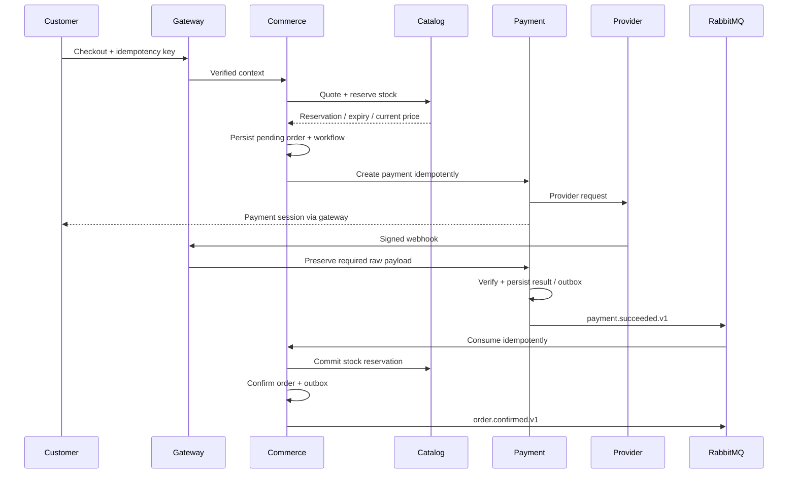

# Architecture and application workflows

[Back to README](../README.md)

## Architecture contract

Services independently start, stop, test and deploy hongi. Monorepo source organize karta hai; independent runtime, private contracts aur data ownership microservices boundaries establish karte hain.

Inventory initially catalog ke andar; cart/coupons/orders/shipments/returns commerce ke andar. Extra services tab extract karo jab workload ya team ownership justify kare.

## Service map

Every NestJS app uses internal container port `3000`; service DNS names distinguish them. Admin static server uses `8080`. Host mappings below development-only hain.

| App          | Responsibility                                                       | Local host port           | Database              |
| ------------ | -------------------------------------------------------------------- | ------------------------- | --------------------- |
| Storefront   | SEO/catalog/account/cart customer UI                                 | 3000                      | None                  |
| Admin        | Management dashboard/forms                                           | 5173 dev / 8080 container | None                  |
| API Gateway  | Public `/api/v1`, routing, coarse auth, rate limits, aggregation     | 4000                      | None                  |
| Identity     | Credentials, Google OAuth, RBAC, profile, addresses, sessions        | 4001                      | `random_identity`     |
| Catalog      | Products/categories/variants/attributes/images/reviews/search/stock  | 4002                      | `random_catalog`      |
| Commerce     | Guest/customer cart, coupons, checkout saga, orders/shipping/returns | 4003                      | `random_commerce`     |
| Payment      | Provider requests, verified webhooks, refunds/reconciliation         | 4004                      | `random_payment`      |
| Content      | Homepage/CMS/gallery/policies/contact/B2B enquiries/warranty         | 4005                      | `random_content`      |
| Notification | Email intent/templates/delivery/retry                                | 4006 health only          | `random_notification` |

Admin APIs stay with owners; no separate admin business DB. Gateway holds no pricing/coupon/payment rules. Worker needs an internal health HTTP listener alongside its broker consumer.

## Database ownership

Start with one PostgreSQL instance, six databases, separate runtime logins and migration roles. Runtime roles get necessary DML only; migration credentials are used only by migration jobs. No application gets a DB superuser account.

Restrict CONNECT/schema/default privileges and test forbidden access. Separate database names alone do not guarantee least privilege.

| Database     | Main tables                                                                                                                                                                                      |
| ------------ | ------------------------------------------------------------------------------------------------------------------------------------------------------------------------------------------------ |
| Identity     | `users`, `oauth_accounts`, `roles`, `user_roles`, `addresses`, `refresh_sessions`                                                                                                                |
| Catalog      | `categories`, `products`, `product_categories`, `product_variants`, `product_images`, `attributes`, `attribute_values`, `variant_attribute_values`, `reviews`, `inventory`, `stock_reservations` |
| Commerce     | `carts`, `cart_items`, `coupons`, `coupon_redemptions`, `orders`, `order_items`, `shipments`, `return_requests`, `order_status_history`, `checkout_workflows`                                    |
| Payment      | `payments`, `payment_attempts`, `webhook_receipts`, `refunds`                                                                                                                                    |
| Content      | `pages`, `banners`, `gallery_items`, `contact_messages`, `corporate_enquiries`, `warranty_registrations`                                                                                         |
| Notification | `notification_jobs`, `delivery_attempts`, `templates`                                                                                                                                            |

Event-producing owners add `outbox_events`; consumers add `processed_events` or equivalent unique inbox records.

- Use UUIDs plus source-system/source-ID mapping for migrated records.
- Money: PostgreSQL `numeric` + decimal arithmetic, or integer minor units. Explicit currency, initially INR.
- UTC `timestamptz`; display local time in UI.
- Order items/addresses preserve purchase snapshots. Product edits never rewrite historical purchases.
- Variant SKU is the stock unit; simple products receive a default variant.
- Unique slug/SKU/order number/idempotency key/provider transaction constraints.
- Atomic stock operations and constraints enforce non-negative quantities.
- No cross-service SQL joins/FKs/shared ORM client; use APIs/events for references.
- Sanitize imported rich HTML before rendering and preserve safe media references.

Proposed ORM: Prisma, one schema/client/migration history per service. Verify chosen Prisma/Node/Nest/ESM compatibility before installation; existing starter uses NodeNext/ESM.

## API map

Public prefix `/api/v1`; internal owner APIs `/internal/v1`; health `/health/live` and `/health/ready`.

| API group                                                                 | Owner    |
| ------------------------------------------------------------------------- | -------- |
| `/auth/*`, `/account/profile`, `/account/addresses`                       | Identity |
| `/products`, `/products/:slug`, `/categories`, `/search`, product reviews | Catalog  |
| `/cart/*`, `/checkout`, `/account/orders/*`, `/account/returns/*`         | Commerce |
| `/payments/*`, `/webhooks/payments/:provider`                             | Payment  |
| `/pages/*`, `/contact`, `/corporate-enquiries`, `/warranties`             | Content  |
| `/admin/products/*`, `/admin/categories/*`, `/admin/attributes/*`         | Catalog  |
| `/admin/orders/*`, `/admin/coupons/*`, `/admin/returns/*`                 | Commerce |
| `/admin/customers/*`, `/admin/roles/*`                                    | Identity |
| `/admin/content/*`, `/admin/enquiries/*`, `/admin/warranties/*`           | Content  |

Gateway and owners both enforce permissions. Strip caller-supplied identity headers; owners validate a signed user context/access token. Private network alone is not authentication. Generate frontend types/client from tested OpenAPI; stable errors include code, user-safe message and request ID.

## Authentication

Identity owns short-lived access tokens and rotating refresh sessions. Secure HttpOnly cookies, explicit SameSite/domain/path rules and CSRF/origin checks for cookie-authenticated changes. Avoid refresh tokens in localStorage; credentials CORS uses explicit allowed origins.

OAuth needs one-use state, provider identity validation, verified account-linking rules and fail-closed missing credentials. Admin/customer roles and access policies are explicit. Persist signing keys securely; support rotation/revocation.

Guest cart uses an opaque signed cookie. Login merges carts respecting quantities/stock. Guest order access uses scoped signed links or verified OTP, never only a predictable order number. Rate-limit auth/tracking/forms.

## Service communication

Internal HTTP handles synchronous quotes, inventory reservation and payment creation. Clients have deadlines, bounded retries and write idempotency. Public product pages can use cache; checkout revalidates authoritative prices/stock.

RabbitMQ topic exchange `random.events`; each subscribing service has a distinct queue, worker replicas share their owner queue. Independent subscribers must not compete on one shared queue.

Example event schema to implement:

```json
{
  "eventId": "uuid",
  "type": "payment.succeeded.v1",
  "occurredAt": "2026-10-10T09:00:00Z",
  "producer": "payment-service",
  "correlationId": "checkout-request-uuid",
  "aggregateId": "payment-uuid",
  "aggregateVersion": 3,
  "data": {
    "paymentId": "payment-uuid",
    "orderId": "order-uuid",
    "amountMinor": 149900,
    "currency": "INR"
  }
}
```

Initial events: `order.placed.v1`, `order.confirmed.v1`, `order.cancelled.v1`, `payment.succeeded.v1`, `payment.failed.v1`, `refund.succeeded.v1`, `shipment.updated.v1`, `warranty.submitted.v1`.

Persist state change + outbox in one local DB transaction. Publish with confirms; mark outbox sent after broker acceptance. Consumer commits effect + dedupe before ACK. Use durable queues/persistent messages, bounded retries, DLQ and runtime schema validation. Crash/retry can repeat delivery; idempotency is required. [NestJS RabbitMQ](https://docs.nestjs.com/microservices/rabbitmq)

Aggregate versions and guarded transitions handle out-of-order events. Notification intent/delivery records persist before external calls. Provider idempotency helps; SMTP cannot guarantee exactly-once delivery.

## Checkout workflow



Implement as a **persisted saga**, not one cross-database transaction:

1. Validate cart/address/coupon; calculate totals server-side.
2. Reserve variant stock atomically with quote/reservation expiry.
3. Persist pending order and workflow. Failure after reservation compensates by release/expiry.
4. Create provider payment idempotently; uncertain timeout enters reconciliation, not automatic second payment creation.
5. Verify webhook signature, transaction, amount/currency/order mapping and replay protection. Redirect alone cannot mark paid.
6. Commit reservation, then mark fulfillment eligibility; repeat messages cause safe transitions.
7. Failure/cancellation releases stock. Late success after expiry re-reserves or refunds/escalates.
8. COD has its own acceptance path; accepted COD order remains unpaid until collection confirmation.
9. Scheduled reconciliation resolves stuck workflows, missed callbacks and uncertain refunds.

Separate payment/order/reservation/shipping/refund states; guard transitions with version/locking checks and retain history. Returns verify purchased items/ownership/quantity; refunds require provider confirmation.

## Frontend, files and scaling

Next.js renders SEO pages and consumes gateway APIs; admin uses React/Vite and typed hooks. Keep business logic in NestJS. Never cache private account responses as public SSR content. Preserve routes/slugs, metadata, canonical URLs, sitemap and redirect maps.

Product media can be public/CDN-backed; warranty invoices are private with short-lived signed URLs. Validate upload size/type, randomize keys and store object keys in DB. Local disk requires a persistent media/upload component and backup; container writable layers are not storage.

Multiple replicas require shared sessions, idempotency, concurrent outbox row claiming and safe dedupe. Start each app with one replica, PostgreSQL/RabbitMQ with one instance. Increasing StatefulSet replicas does not configure replication. Server HA later needs additional machines plus a data replication/recovery strategy.
