# CI/CD: GitHub Actions → GHCR → K3s VPS

[Back to README](../README.md)

## Pipeline contract

CI validates changes; image jobs produce immutable artifacts; CD promotes a tested release to an environment. Build on hosted CI runners, not the production VPS. Staging and production use the same app image digests. Configuration/secrets differ per environment.

This document specifies workflows/scripts to implement. No `.github/workflows` files or deployment scripts have been installed by this documentation task.

```mermaid
flowchart LR
    PR[Feature PR] --> Checks[Lint / Types / Tests / Build / Container Smoke]
    Checks --> Merge[Merge main]
    Merge --> Images[Build Docker images]
    Images --> Registry[Push GHCR and record digests]
    Registry --> Bundle[Release bundle]
    Bundle --> Stage[Staging migrations + rollout]
    Stage --> Verify[Smoke / browser / sandbox checks]
    Verify --> Promote[Select verified release]
    Promote --> Prod[Production preflight + migrations + rollout]
    Prod --> Observe[Verify and record release]
```



## Branch and release policy

| Event                         | Result                                                       |
| ----------------------------- | ------------------------------------------------------------ |
| Feature branch PR into `main` | Validate only; no production credentials/image publishing    |
| Merge to protected `main`     | Repeat required checks, build/publish images, deploy staging |
| Verified staging release      | Record release ID/digests/test results                       |
| Production dispatch           | Promote a selected verified main release                     |
| Failed staging                | Mark release ineligible for production                       |
| Emergency rollback            | Redeploy a previously verified compatible release bundle     |

Protect `main`, require checks and review where available, review workflow/deployment-script changes carefully. Initially explicit production dispatch is easier to understand for a solo developer; later automatic production promotion may use the same gates. If GitHub required reviewers are available, configure them as a product choice; their availability depends on plan/visibility. [GitHub deployment environments](https://docs.github.com/en/actions/reference/workflows-and-actions/deployments-and-environments)

PR jobs have no deploy secrets. Never check out/run untrusted PR code in a privileged `pull_request_target` workflow. Pin external actions to reviewed full commit SHAs; keep token permissions minimal. [GitHub Actions security](https://docs.github.com/en/actions/reference/security/secure-use)

## Files to implement

| Workflow                 | Responsibilities                                                                                      |
| ------------------------ | ----------------------------------------------------------------------------------------------------- |
| `ci.yml`                 | Install frozen lockfile, lint/typecheck/unit/integration/build, Docker smoke, contracts, selected E2E |
| `build-release.yml`      | Validate trusted main, build app/migration images, scan, publish, create manifest/bundle              |
| `deploy-staging.yml`     | Consume release bundle; migrate/roll out staging; verify; mark eligible                               |
| `promote-production.yml` | Validate eligibility; serial deployment; production migrations/rollout/smoke; record state            |

Use reusable workflows/explicit job dependencies so publish cannot run before checks pass. Never trigger privileged deployment from arbitrary artifacts without validating their originating main workflow/commit/repository.

## CI checks

1. Checkout trusted revision; install pinned supported Node and pnpm.
2. `pnpm install --frozen-lockfile`.
3. Build shared packages in dependency order where type resolution needs output.
4. Lint/typecheck/unit tests; fail missing required package scripts.
5. Start isolated PostgreSQL/RabbitMQ/Redis test stack; bootstrap roles and migrations.
6. Integration/contract tests and frontend build.
7. Build runtime and migration images; boot containers, probe health and production entrypoints.
8. Disposable E2E stack exercises target browser flows; no live provider charges or production emails.
9. Upload reports with secrets/PII redacted; cleanup disposable test data/containers.

Current root package has lint/build/test/test:e2e, but no monorepo typecheck/integration contracts yet. Update scripts as part of foundation; don't paste recursive CI commands before packages implement them.

## Build/publish jobs

Initial build matrix includes all nine apps: storefront, admin, gateway, identity, catalog, commerce, payment, content, notification. Migration images are additional targets for six owners as needed. Later changed-app detection must include transitive shared package changes, lockfile changes, Dockerfiles and contracts; never rely on `apps/foo/**` alone.

Use root build context with app-specific Dockerfile. Target the VPS CPU architecture confirmed in preflight. Registry owner/image names must be lowercase. Authenticate image publishing with `GITHUB_TOKEN` and `packages: write` for authorized jobs. VPS pull credentials are separate read-only credentials. [Docker images with GitHub Actions](https://docs.github.com/en/actions/tutorials/publish-packages/publish-docker-images?learn=continuous_deployment)

Container image scanning/secret checks block release on the configured policy. Record base image/dependency provenance; define an exception process for issues with no fix rather than silently disabling scans. Select and pin the scanner independently.

## Workflow wiring example

**Structural template only.** Replace every `REPLACE_*` value with reviewed action SHA/tool versions and implement referenced scripts/workflows first. This template deliberately does not guess dependency versions or expose secrets.

```yaml
name: build-release
on:
  push:
    branches: [main]
permissions:
  contents: read
concurrency:
  group: build-release-${{ github.ref }}
  cancel-in-progress: false
jobs:
  validate:
    uses: ./.github/workflows/ci.yml
  images:
    needs: validate
    runs-on: ubuntu-latest
    permissions:
      contents: read
      packages: write
    strategy:
      fail-fast: false
      matrix:
        app:
          - storefront
          - admin
          - api-gateway
          - identity-service
          - catalog-service
          - commerce-service
          - payment-service
          - content-service
          - notification-worker
    steps:
      - uses: actions/checkout@REPLACE_REVIEWED_COMMIT_SHA
      - uses: docker/setup-buildx-action@REPLACE_REVIEWED_COMMIT_SHA
      - uses: docker/login-action@REPLACE_REVIEWED_COMMIT_SHA
        with:
          registry: ghcr.io
          username: ${{ github.actor }}
          password: ${{ secrets.GITHUB_TOKEN }}
      - name: Set lowercase registry owner
        shell: bash
        env:
          OWNER: ${{ github.repository_owner }}
        run: printf 'IMAGE_OWNER=%s\n' "${OWNER,,}" >> "$GITHUB_ENV"
      - uses: docker/build-push-action@REPLACE_REVIEWED_COMMIT_SHA
        id: image
        with:
          context: .
          file: apps/${{ matrix.app }}/Dockerfile
          platforms: linux/amd64
          push: true
          tags: ghcr.io/${{ env.IMAGE_OWNER }}/random-studio-${{ matrix.app }}:sha-${{ github.sha }}
          cache-from: type=gha,scope=${{ matrix.app }}
          cache-to: type=gha,mode=max,scope=${{ matrix.app }}
      - name: Record image digest
        env:
          APP: ${{ matrix.app }}
          IMAGE_OWNER: ${{ env.IMAGE_OWNER }}
          DIGEST: ${{ steps.image.outputs.digest }}
        run: node infra/scripts/record-image.mjs
      - uses: actions/upload-artifact@REPLACE_REVIEWED_COMMIT_SHA
        with:
          name: image-${{ matrix.app }}
          path: release/image-${{ matrix.app }}.json
  bundle:
    needs: images
    runs-on: ubuntu-latest
    steps:
      # Implement: checkout same SHA, download all digest records,
      # verify/scanning results, add migration targets, generate bundle,
      # upload immutable bundle and trigger/reuse staging deployment.
      - run: |
          echo "Replace this placeholder with release-bundle implementation"
          exit 1
```

`ci.yml` must expose `workflow_call` for the reusable job. Matrix records require unique artifact names. `record-image.mjs` validates app/digest and writes JSON from env, not shell-interpolated JSON. Scans and migration-image jobs must be wired before the bundle is marked deployable. The placeholder fails intentionally; this is documentation, not an active workflow.

## Release bundle

Create one archive/artifact per trusted release with:

```text
release-<id>/
├── release.json
├── images/*.json
├── rendered/staging/          # No secrets
├── rendered/production/       # No secrets
├── migrations.json
├── checks.json
└── checksums.txt
```

Example manifest values are placeholders:

```json
{
  "releaseId": "commit-sha-workflow-run-id",
  "sourceCommit": "full-commit-sha",
  "workflowRunId": "trusted-run-id",
  "images": {
    "catalog-service": "ghcr.io/owner/random-studio-catalog-service@sha256:digest",
    "commerce-service": "ghcr.io/owner/random-studio-commerce-service@sha256:digest"
  },
  "migrations": [
    {
      "owner": "catalog-service",
      "mode": "expand",
      "image": "migration-image-at-digest"
    }
  ],
  "compatibility": { "rollbackCompatible": true }
}
```

Include all required images, not only the two illustrated. For partial releases, carry forward tested unchanged digests. Preserve artifact/digest retention longer than rollback window; deleted images cannot be rolled back. Maintain staging verification state bound to release ID/checksum, not just a generic green branch badge.

Never rebuild for production. Public frontend config must be environment-neutral or injected at runtime; private SSR config supplied server-side. Staging fixture content must not be bundled into production images.

## Secrets and access

| Item                                    | Where / purpose                                                  |
| --------------------------------------- | ---------------------------------------------------------------- |
| `GITHUB_TOKEN`                          | Image publish jobs only; least permissions                       |
| VPS host/user/SSH port                  | GitHub environment/repo variables                                |
| Deployment SSH private key              | GitHub staging/production secret; distinct where practical       |
| Verified SSH known-hosts entry          | Protected GitHub config/secret; verify fingerprint independently |
| GHCR read-only token                    | Server/bootstrap Secret for private image pulls                  |
| Application DB/OAuth/payment/email keys | Environment-scoped Kubernetes Secrets; not every CI job          |
| Migration DB credentials                | Only migration Jobs                                              |
| Scoped deployment kubeconfig            | Host deployment wrapper identity; never root cluster-admin in CI |
| Backup credentials                      | Backup job identity; separate restore/admin permissions          |

GHCR's build token and server pull authentication have different purposes; configure package access explicitly. [GHCR authentication and pulls](https://docs.github.com/en/packages/working-with-a-github-packages-registry/working-with-the-container-registry)

SSH uses verified host keys and non-root account. Do not use `StrictHostKeyChecking=no` or blindly trust a newly obtained `ssh-keyscan` result. Docker group/root cluster access is effectively administrative; restrict deployment wrappers and protect trusted repository code.

## Deployment transport

Initial design: hosted GitHub runner securely copies a verified release bundle to `/opt/random-studio/releases/<id>` and invokes the host's reviewed deployment wrapper over SSH. This keeps 6443 private. Open SSH only to approved access paths; hosted-runner source IP is not fixed, so choose provider-supported allowlisting, short-lived access or a VPN/tunnel model instead of inventing a permanent runner IP.

Upload to a temporary release directory, verify checksums/source/eligibility, then atomically make it available. Never use `git pull && npm install` as production release deployment. Source configs/scripts and image digests are versioned together; no secret contents in bundles.

## Deployment script algorithm

Implement `deploy-k3s.sh` with strict error handling and a per-environment `flock`. Environment/release ID are allowlisted and validated; file paths stay under the deployment root.

```text
1. Acquire lock; reject concurrent deploy/rollback/infra upgrade.
2. Verify trusted release, checksum, staging eligibility, image existence.
3. Check disk/RAM/node health, DB/broker availability, backup freshness.
4. Save current image/config release pointer as previous candidate.
5. Render new owner migration Jobs with unique release names.
6. Apply compatible expand migrations; wait for Job completion.
7. If any migration fails: stop rollout, retain logs, inspect schema state.
8. Apply release app manifests/config (not DB/PVC bootstrap manifests).
9. Wait for every changed Deployment to become ready.
10. Run internal/public smoke tests, auth checks and expected release checks.
11. If healthy: atomically record new current release + verification report.
12. If unhealthy: redeploy previous compatible bundle or halt for recovery.
```

Do not update success pointer before smoke passes. Secret rotation and infrastructure upgrades are separate changes with their own verification/rollback. Deploy/rollback commands from CI invoke this algorithm, not unrestricted remote shell snippets assembled from user input.

## Migration strategy

**Expand → migrate/backfill → switch reads/writes → contract in later release.**

Add nullable/defaulted columns or tables first; old replicas remain compatible. Backfill through resumable monitored jobs. Only remove old fields in a later release after rollback window and producer/consumer compatibility checks.

Migrations run once per owner/release in Jobs, not in every app pod startup. Prisma migration image must contain CLI/schema/migrations. Jobs use migration credentials; app Deployments do not. Use DB advisory/job locks so two releases cannot race schema changes. Keep migration/backfill execution time bounded and avoid long locks on busy tables.

Migrations across six databases are not atomic. Record each owner's status; on partial failure don't pretend everything rolled back. PostgreSQL rollback depends on exact statements/migration tooling. Restore is disaster recovery, not routine deploy rollback.

## Staging verification and promotion

Staging uses separate data, payment sandbox credentials and email sink. Verify deployed image digests/release ID, readiness, public TLS/routes, admin/customer auth, catalog CRUD, cart/COD, sandbox webhook/refund, queue/outbox and file permissions.

Production job requires eligible release ID, protected main source, same digest list, compatible migration plan, fresh backup and deployment lock. Use environment secrets and branch restrictions if available; otherwise a trusted manual dispatch workflow plus scoped repository secrets and eligibility checks.

Deployment concurrency example:

```yaml
concurrency:
  group: deploy-production
  cancel-in-progress: false
```

Do not cancel an in-progress production migration/deployment to start a newer one. GitHub queue behavior and server lock both need consideration; only one production state change runs at a time. [GitHub deployment concurrency](https://docs.github.com/en/actions/how-tos/deploy/configure-and-manage-deployments/control-deployments?apiVersion=2022-11-28)

## Rollback

Preferred rollback: previous **release bundle** reapplication, preserving consistent image/config/contract combinations. `kubectl rollout undo` on one service can mix incompatible versions; use it only for a known isolated compatible change.

Automatic app rollback is permitted only when old code remains compatible with completed schema/events/config. Do not auto-reverse destructive migrations. If incompatible, stop promotion, pause affected writes as needed and run a forward fix/recovery plan. New customer orders/payments must be preserved.

Never delete PVCs, restore stale customer DBs or run schema reset as an automatic deployment failure response. See [operations runbook](operations-migration.md) for incident recovery.

## CI/CD acceptance gate

- Bad lint/test/build fails before publishing or deployment.
- Missing script/image/digest or unverified release cannot promote.
- Fork PR cannot obtain deploy/production secrets.
- Production uses the exact staging-tested digest map.
- Two deployment requests serialize safely.
- Failed migration blocks rollout with owner-level evidence.
- Failed readiness/smoke fails the release; compatible rollback exercised.
- App logs/version endpoint identify deployed release without exposing secrets.
- A complete CI→staging→production promotion is demonstrated before launch.
